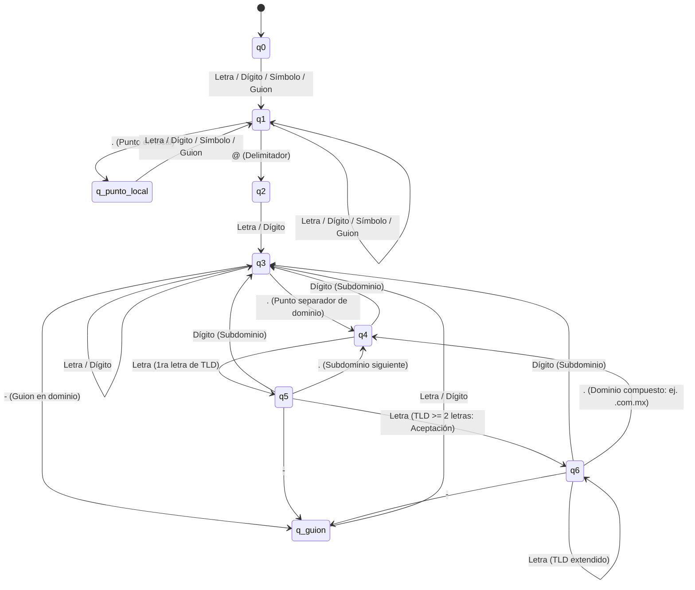

# 🛡️ Sistema de Verificación y Generación de Credenciales Seguras
> **Modelado con Teoría de Autómatas Finitos (AFD), Expresiones Regulares y Estándares RFC 5322 / NIST SP 800-63B**

Este proyecto implementa una aplicación de escritorio moderna desarrollada en Python con **CustomTkinter** que combina la **Teoría de Autómatas y Lenguajes Formales** con la **Ciberseguridad Práctica**. El sistema valida y genera correos electrónicos y contraseñas robustas mediante Autómatas Finitos Deterministas (AFD) y Expresiones Regulares (Regex).

---

## 📑 Tabla de Contenidos
1. [¿Cómo Ayudan los Autómatas y las Expresiones Regulares?](#-cómo-ayudan-los-autómatas-y-las-expresiones-regulares)
2. [Definición Formal del Autómata de Correo (AFD)](#-definición-formal-del-autómata-de-correo-afd)
3. [Expresiones Regulares en el Proyecto](#-expresiones-regulares-en-el-proyecto)
4. [Estándares de Seguridad Implementados](#-estándares-de-seguridad-implementados)
5. [Estructura y Funcionamiento del Código](#-estructura-y-funcionamiento-del-código)
6. [Módulos de la Interfaz Gráfica](#-módulos-de-la-interfaz-gráfica)
7. [Requisitos e Instalación](#-requisitos-e-instalación)

---

## 🧠 ¿Cómo Ayudan los Autómatas y las Expresiones Regulares?

En las Ciencias de la Computación, validar cadenas de texto complejas (como direcciones de correo o contraseñas) no debe hacerse con reglas dispersas o funciones condicionales improvisadas. La base teórica formal se sustenta en:

### 1. Autómatas Finitos Deterministas (AFD)
Un **AFD** es un modelo matemático de computación que procesa una cadena símbolo a símbolo, cambiando de estado según una función determinista de transición.
- **Trazabilidad en Tiempo Real**: A diferencia de una simple función booleana, el AFD permite conocer exactamente el camino recorrido $\delta(q_i, \sigma)$ y el motivo formal por el cual una cadena fue rechazada (ej. un punto duplicado en la parte local, un guion al inicio de un dominio o un TLD de menos de 2 caracteres).
- **Generación Inversa Guiada**: El autómata no solo sirve para validar; también guía la generación de correos. El generador navega por las transiciones válidas del grafo para construir cadenas que matemáticamente pertenezcan al lenguaje $L(M)$.
- **Eficiencia Lineal $\mathcal{O}(n)$**: El autómata analiza la entrada en un único recorrido de izquierda a derecha sin necesidad de retrocesos (*backtracking*).

### 2. Expresiones Regulares (Regex)
Por el **Teorema de Kleene**, los Autómatas Finitos y las Expresiones Regulares son equivalentes: ambos definen la familia de **Lenguajes Regulares (Tipo 3 de la Jerarquía de Chomsky)**.
- En este proyecto, las expresiones regulares se emplean para la verificación léxica de contraseñas de alta velocidad y para la limpieza y normalización morfológica de palabras base.

---

## 🔬 Definición Formal del Autómata de Correo (AFD)

El analizador léxico y sintáctico de correos modela la 5-tupla formal:

$$M = (Q, \Sigma, \delta, q_0, F)$$

### 1. Conjunto Finito de Estados ($Q$)
- $q_0$: Estado inicial (espera el primer carácter de la parte local).
- $q_1$: Parte local válida (acumulación de caracteres alfanuméricos o símbolos permitidos).
- $q_{\text{punto\_local}}$: Estado temporal tras leer un punto en la parte local (evita puntos consecutivos `..` o punto antes de `@`).
- $q_2$: Inicio de etiqueta de dominio o subdominio (justo después del delimitador `@` o de un punto de dominio).
- $q_3$: Cuerpo de etiqueta de dominio o subdominio (alfanumérico).
- $q_{\text{guion}}$: Lectura de guion `-` dentro del dominio (impide que una etiqueta termine en guion).
- $q_4$: Inicio de Dominio de Nivel Superior (TLD) tras leer el punto separador.
- $q_5$: Primer carácter alfabético del TLD leído (longitud 1).
- $q_6$: **Estado de aceptación final** (TLD con $\ge 2$ letras, dominio completo válido).

### 2. Alfabeto de Entrada ($\Sigma$)
$$\Sigma = \Sigma_{\text{letras}} \cup \Sigma_{\text{dígitos}} \cup \Sigma_{\text{símbolos}} \cup \{ \text{'@'}, \text{'.'}, \text{'-'} \}$$
- $\Sigma_{\text{letras}} = \{a, \dots, z, A, \dots, Z\}$
- $\Sigma_{\text{dígitos}} = \{0, 1, \dots, 9\}$
- $\Sigma_{\text{símbolos}} = \{!, \#, \$, \%, \&, ', *, +, /, =, ?, \text{\textasciicircum}, \_, `, \{, |, \}, \sim\}$

### 3. Estados de Aceptación ($F$)
$$F = \{ q_6 \}$$
Una cadena es reconocida como un correo válido según RFC 5322 **únicamente si el autómata consume toda la cadena y finaliza en $q_6$**.

### 4. Diagrama de Transición de Estados (Mermaid)



---

## 🔑 Expresiones Regulares en el Proyecto

### 1. Validación de Contraseñas (NIST SP 800-63B)
La regla sintáctica de las contraseñas se formaliza con la siguiente expresión regular:

```python
r"^[a-zA-ZñÑáéíóúÁÉÍÓÚüÜ0-9!#$%&'*+\-/=?^_`{|}~\.]{8,64}$"
```

- **`^` y `$`**: Delimitadores de anclaje para asegurar que la totalidad de la cadena cumpla la regla sin caracteres extraños ocultos.
- **`[a-zA-ZñÑáéíóúÁÉÍÓÚüÜ]`**: Soporte integral para caracteres alfabéticos ASCII y el alfabeto extendido del español (`ñ`, `Ñ` y vocales con acento/diéresis).
- **`[0-9]`**: Dígitos decimales.
- **`[!#$%&'*+\-/=?^_`{|}~\.]`**: Símbolos y caracteres especiales seguros.
- **`{8,64}`**: Cuantificador estricto según la recomendación del NIST (longitud mínima de 8 y máxima de 64 caracteres).

### 2. Normalización de Nombres en el Generador
Para transformar nombres de usuario en partes locales válidas según RFC 5322:
- Remoción de tildes mediante descomposición Unicode `NFD`.
- Sustitución de `ñ/Ñ` por `n/N`.
- Filtro de caracteres no permitidos: `re.sub(r'[^a-zA-Z0-9\s._-]', '', texto)`.

---

## 🔒 Estándares de Seguridad Implementados

| Estándar | Propósito en el Proyecto | Reglas Clave |
| :--- | :--- | :--- |
| **RFC 5322** | Formato de Mensajes de Internet (Correo) | • No permite puntos consecutivos `..`<br>• La parte local no inicia ni termina en punto<br>• El dominio no inicia ni termina con guion `-`<br>• El TLD debe tener al menos 2 letras alfabéticas |
| **NIST SP 800-63B** | Guía de Identidades Digitales (Contraseñas) | • Longitud mínima de 8 caracteres<br>• Permite símbolos y caracteres Unicode (`ñ`, `Ñ`)<br>• No trunca contraseñas<br>• Clasificación por entropía (Baja, Media, Factor Único $\ge 15$ car.) |

---

## 🏗️ Estructura y Funcionamiento del Código

El archivo principal [`verificador-y-generador-correo-contraseña.py`](file:///C:/Users/DELL/Desktop/proy%20automatas/verificador-y-generador-correo-contrase%C3%B1a.py) se divide en dos capas desacopladas:

### 1. Capa Lógica (`ValidadorLexicoAutomatas`)
- `validar_correo_afd(correo)`: Ejecuta la simulación determinista del autómata, registrando cada paso en un reporte de transiciones $[c] \text{ Transición: } q_a \to q_b$.
- `validar_contrasena(password)`: Evalúa la longitud y la expresión regular, clasificando la robustez según el estándar NIST.
- `generar_variantes_correo(palabras, dominio, cantidad=6)`: Combina más de 50 patrones corporativos y académicos (iniciales, apellidos invertidos, prefijos `soy.`, `contact.`, roles `dev`, `pro`, años `2026`) y **comprueba cada candidato contra el AFD antes de presentarlo**.
- `generar_contrasena_guiada(longitud)`: Genera contraseñas criptográficas pseudoaleatorias uniformes con longitud configurable entre 8 y 64 caracteres.

### 2. Capa de Presentación (`AppCredenciales`)
- Diseñada con **CustomTkinter** en paleta *Obsidian Cyber-Tech* (`#080c16`, `#111726`, `#6366f1`).
- Manejo reactivo de eventos (`<KeyRelease>`) para validación instantánea mientras el usuario escribe.

---

## 🖥️ Módulos de la Interfaz Gráfica

La aplicación cuenta con **3 pestañas principales independientes**:

```
[ ⚡ Validar en Tiempo Real ]   [ 📧 Generador de Correos (AFD) ]   [ 🔐 Generador de Contraseñas (NIST) ]
```

### Pestaña 1: ⚡ Validar en Tiempo Real
- **Caja de Correo**: Detección dinámica de formato con insignia de estado.
- **Caja de Contraseña**: Con switch para mostrar/ocultar y medidor de seguridad continuo.
- **Monitor de Trazabilidad y Estados Formales (AFD)**:
  - Muestra el recorrido exacto por los estados del autómata en tiempo real.
  - Indicador de estado dinámico (`⚪ Listo`, `✅ Cumple Formalismo`, `❌ Falla Detectada`).
  - Botones directos `📋 Copiar Traza` y `🧹 Limpiar Registro`.
  - Barra de estadísticas con conteo de caracteres y estado final.

### Pestaña 2: 📧 Generador de Correos (AFD)
- Permite ingresar palabras o nombres base (1, 2, 3, 4+ palabras) o dejarlo vacío para generación aleatoria.
- Selector de dominio con opciones estándar (`gmail.com`, `outlook.com`), corporativas (`empresa.com`), compuestas (`universidad.edu.mx`, `portal.gob.mx`) o aleatorias.
- **Cuadrícula interactiva de 6 variantes**: Cada combinación generada se muestra en un botón de selección directa.
- Botón `🔄 Más Variantes` para calcular 6 combinaciones nuevas al instante.

### Pestaña 3: 🔐 Generador de Contraseñas (NIST)
- **Presets Rápidos**: Botones directos para longitudes estándar: `8 (Mínimo NIST)`, `12 (Media)`, `16 (Recomendado)`, `24 (Fuerte)`, `32 (Máxima)`.
- Slider continuo de 8 a 64 caracteres.
- Badge explícito de seguridad conforme a NIST SP 800-63B.
- Botón `📋 Copiar Contraseña` y botón `🔍 Probar en Validador` para enviarla automáticamente a la pestaña de auditoría.

---

## 📦 Requisitos e Instalación

### Requisitos del Sistema
- **Python**: Versión 3.8 o superior.
- **Librería de Interfaz**: `customtkinter` (versión 6.0.0 o superior).

### Instalación de Dependencias
```bash
pip install customtkinter
```

### Ejecución de la Aplicación
```bash
python "verificador-y-generador-correo-contraseña.py"
```

---

## 🧪 Casos de Prueba del Autómata (AFD)

| Entrada Evaluada | Estado Final | Veredicto | Explicación Formal |
| :--- | :---: | :---: | :--- |
| `usuario@gmail.com` | **$q_6$** | ✅ **Válido** | Recorrido canónico completo. |
| `juan.perez@sub.empresa.com.mx` | **$q_6$** | ✅ **Válido** | Subdominio y TLD compuesto (`.com.mx`). |
| `usuario..doble@gmail.com` | Falló en $q_{\text{punto\_local}}$ | ❌ **Inválido** | Puntos consecutivos no permitidos por RFC 5322. |
| `usuario@dominio` | $q_3$ | ❌ **Inválido** | Estructura incompleta: falta el TLD y punto final. |
| `usuario@-dominio.com` | Falló en $q_2$ | ❌ **Inválido** | La etiqueta de dominio no puede iniciar con guion. |
| `usuario@dominio.c` | $q_5$ | ❌ **Inválido** | El TLD debe tener al menos 2 caracteres. |
